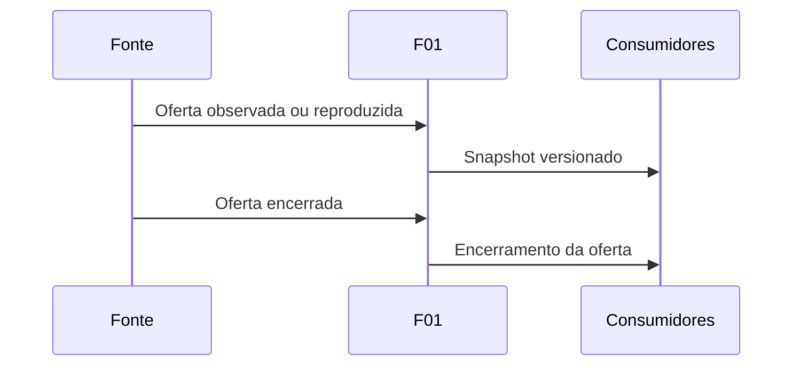

# F01 — Dados e ciclo de vida da oferta

**Fonte:** [PRD 0.2](../../PRD.md) · **Estado:** rascunho técnico para revisão. · [Contrato](contract.md) · [Plano](plan.md)

## Escopo e evidência

F01.1. Normalizar as ofertas reproduzidas e, no piloto, observar a oferta ativa da Uber para consumo local. O workspace contém o PRD e não tinha código ou configuração de build na inspeção. As decisões de implementação abaixo são propostas.

**Contratos de entrada:** Nenhum requisito interno anterior.

## Comportamento e aceite

| Caso | Condição | Resultado observável exigido |
| --- | --- | --- |
| F01-A | Dois trechos, totais ou combinação parcial | Guardar o escopo de cada medida. Preservar zero observado e marcar dado ausente, ambíguo ou ilegível como desconhecido. |
| F01-B | Duas ofertas idênticas sucessivas, atualização repetida ou evento antigo | Nova aparição após encerramento recebe outro ID. Repetição não cria oferta. Evento antigo não reabre nem substitui a mais recente. |
| F01-C | Oferta some, expira, é aceita ou recusada, ou app de origem perde primeiro plano | Emitir encerramento uma vez e limpar a oferta ativa. Sem captura autorizada, nenhuma oferta real sai do adaptador. |
| F01-D | Campos financeiros válidos, mas geometria indisponível | Publicar os dados com geometria desconhecida. F05 decide se pode exibir. |

## Decisões técnicas

O adaptador de reprodução e o adaptador Android devem compartilhar a normalização. Proposta para o piloto: inspecionar a árvore de acessibilidade com consentimento, limitada ao app alvo, e medir campos e limites visíveis em aparelhos reais. Validar permissões e condições de distribuição antes de escolher o adaptador de produção.

## Estratégia de verificação

Cada caso (F01-A, F01-B, F01-C, F01-D) passa quando o resultado da tabela é observado pela interface do contrato ou pelo fluxo visível descrito no plano. Usar ofertas sintéticas para conformidade e regressão. Usar dados anonimizados ou aparelho real nos pontos de integração previstos no plano. Registrar variante, ambiente e evidência. [Gates e estado do repositório](../README.md#qualidade-e-evidências)
