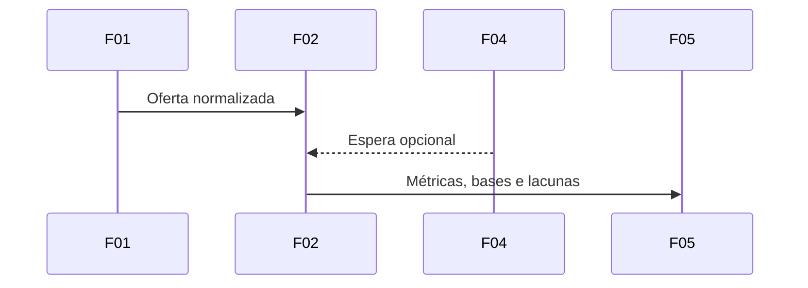

# F02 — Resultado financeiro determinístico

**Fonte:** [PRD 0.2](../../PRD.md) · **Estado:** rascunho técnico para revisão. · [Contrato](contract.md) · [Plano](plan.md)

## Escopo e evidência

F02.1. Calcular ganho por km, ganho por hora, lucro estimado e líquido por hora. Incluir deslocamento até a coleta ou embarque e apresentar efeito da espera quando disponível. O workspace contém o PRD e não tinha código ou configuração de build na inspeção. As decisões de implementação abaixo são propostas.

**Contratos de entrada:** [F01](../F01-dados-da-oferta/contract.md)

## Comportamento e aceite

| Caso | Condição | Resultado observável exigido |
| --- | --- | --- |
| F02-A | Total válido e trechos redundantes | Usar total uma vez. Se inexistente, somar os dois trechos completos. Divergência material identificada torna a medida indisponível. |
| F02-B | Valor válido, distância zero ou tempo ausente | Manter sinais independentes. Divisão por zero ou dado inválido produz métrica indisponível. |
| F02-C | Custo cadastrado e despesa conhecida; despesa adicional desconhecida | Subtrair somente custos disponíveis. Rotular a estimativa e sinalizar despesas desconhecidas sem tratá-las como pagas ou incluídas. |
| F02-D | Espera histórica disponível, já inclusa ou inclusão desconhecida | Acrescentar somente quando confirmada a exclusão da espera. Manter cenário base e mostrar cenário ajustado quando calculável. |

## Decisões técnicas

Motor local de cálculo. Proposta de arredondar só na interface, com comparação contra metas em precisão integral/racional. Tolerância de divergência entre total e trechos deve refletir o arredondamento dos cartões analisados e fica pendente.

## Estratégia de verificação

Cada caso (F02-A, F02-B, F02-C, F02-D) passa quando o resultado da tabela é observado pela interface do contrato ou pelo fluxo visível descrito no plano. Usar ofertas sintéticas para conformidade e regressão. Usar dados anonimizados ou aparelho real nos pontos de integração previstos no plano. Registrar variante, ambiente e evidência. [Gates e estado do repositório](../README.md#qualidade-e-evidências)
