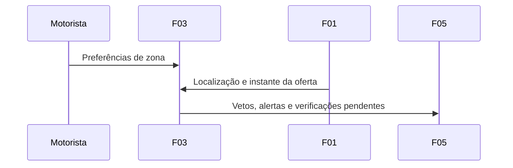

# F03 — Preferências por bairro e zona

**Fonte:** [PRD 0.2](../../PRD.md) · **Estado:** rascunho técnico para revisão. · [Contrato](contract.md) · [Plano](plan.md)

## Escopo e evidência

F03.1. Configurar bairros ou áreas desenhadas para alertar ou evitar embarque, coleta e destino, inclusive por horário. O workspace contém o PRD e não tinha código ou configuração de build na inspeção. As decisões de implementação abaixo são propostas.

**Contratos de entrada:** [F01](../F01-dados-da-oferta/contract.md)

## Comportamento e aceite

| Caso | Condição | Resultado observável exigido |
| --- | --- | --- |
| F03-A | Ponto dentro da zona ou sobre sua borda, papel e horário aplicáveis | Borda conta como dentro. Emitir alerta ou veto conforme preferência. |
| F03-B | Sobreposição de zonas e faixa que cruza meia-noite | Veto prevalece sobre alerta. Interpretar horário local, início incluso e fim exclusivo. |
| F03-C | Papel exigido sem localização confiável, bairro homônimo ou fontes em conflito | Marcar verificação como desconhecida. Regra obrigatória pendente impede recomendação aceitar. |
| F03-D | Ponto externo confirmado, regra inativa ou outro papel | Nenhum alerta dessa regra. Faixas inválidas e polígonos degenerados são recusados ao salvar. |

## Decisões técnicas

Proposta: edição no mapa e pacote de bairros e aliases por cidade disponíveis localmente. Polígono desenhado exige coordenada ou resolução local suficientemente precisa. Nome de bairro identificado pode avaliar regra de bairro, com cidade correspondente.

## Estratégia de verificação

Cada caso (F03-A, F03-B, F03-C, F03-D) passa quando o resultado da tabela é observado pela interface do contrato ou pelo fluxo visível descrito no plano. Usar ofertas sintéticas para conformidade e regressão. Usar dados anonimizados ou aparelho real nos pontos de integração previstos no plano. Registrar variante, ambiente e evidência. [Gates e estado do repositório](../README.md#qualidade-e-evidências)
