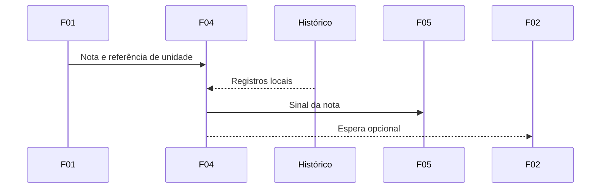

# F04 — Avaliações disponíveis e espera na retirada

**Fonte:** [PRD 0.2](../../PRD.md) · **Estado:** rascunho técnico para revisão. · [Contrato](contract.md) · [Plano](plan.md)

## Escopo e evidência

F04.1. Aplicar preferência de nota por tipo de contraparte. F04.2. Estimar espera por unidade com histórico do próprio entregador. O workspace contém o PRD e não tinha código ou configuração de build na inspeção. As decisões de implementação abaixo são propostas.

**Contratos de entrada:** [F01](../F01-dados-da-oferta/contract.md)

## Comportamento e aceite

| Caso | Condição | Resultado observável exigido |
| --- | --- | --- |
| F04-A | Nota logo abaixo, igual ou acima do mínimo na mesma escala | Apenas abaixo dispara alerta ou veto. Mostrar a origem da avaliação. |
| F04-B | Nota ausente, escala não comparável, papel ambíguo ou unidade homônima | Marcar indisponibilidade. Sem associação por nome de pessoa, endereço ou bairro para inferir reputação. |
| F04-C | Amostra suficiente e recente da mesma unidade, incluindo espera zero observada | Fornecer mediana, tamanho e período. Manter nota e espera como sinais independentes. |
| F04-D | Amostra pequena, antiga, duplicada ou intervalos inválidos | Remover duplicatas do mesmo registro e descartar intervalos inválidos. Sem amostra suficiente, emitir espera desconhecida. |

## Decisões técnicas

Histórico local por motorista. Primeiro protótipo usa registros sintéticos. Propor janela e amostra mínimas configuráveis para a avaliação e acordar valores antes do piloto real.

## Estratégia de verificação

Cada caso (F04-A, F04-B, F04-C, F04-D) passa quando o resultado da tabela é observado pela interface do contrato ou pelo fluxo visível descrito no plano. Usar ofertas sintéticas para conformidade e regressão. Usar dados anonimizados ou aparelho real nos pontos de integração previstos no plano. Registrar variante, ambiente e evidência. [Gates e estado do repositório](../README.md#qualidade-e-evidências)
