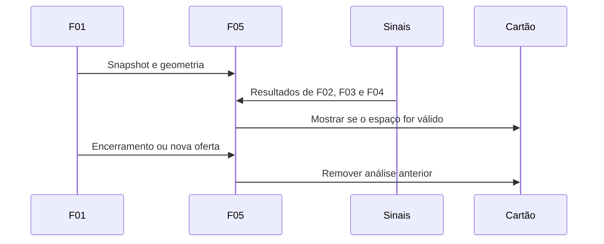

# F05 — Cartão flutuante e recomendação imediata

**Fonte:** [PRD 0.2](../../PRD.md) · **Estado:** rascunho técnico para revisão. · [Contrato](contract.md) · [Plano](plan.md)

## Escopo e evidência

F05.1. Exibir automaticamente a recomendação e até quatro indicadores disponíveis logo acima da oferta, sem obstruir os controles. Destacar o bairro a evitar quando aplicável. A sobreposição está implementada no laboratório Android. A captura da oferta do Uber Driver requer validação em campo.

**Contratos de entrada:** [F02](../F02-resultado-financeiro/contract.md), [F03](../F03-zonas/contract.md), [F04](../F04-avaliacoes-e-espera/contract.md)

## Comportamento e aceite

| Caso | Condição | Resultado observável exigido |
| --- | --- | --- |
| F05-A | Veto confirmado, alerta ou campo obrigatório pendente, ou cenário que atende às metas | Precedência: veto ou abaixo da faixa de recusa → recusar; alerta, faixa intermediária ou pendência essencial → avaliar; demais casos que atendam aos mínimos → aceitar. |
| F05-B | Oferta visível e posição válida, modelo desligado ou sem rede | Mostrar a decisão, até quatro indicadores e o bairro a evitar quando aplicável. Em tela estreita, distribuir os indicadores em duas linhas quando necessário. |
| F05-C | Retângulo desconhecido ou sem espaço, teclado, layout mudou ou permissão retirada | Ocultar se o cartão não couber na área segura. Nenhum controle de origem coberto ou interceptado. |
| F05-D | Dispensa, expiração, troca, aceite, recusa ou perda do primeiro plano | Remover ao observar o encerramento. Dispensa vale para o offerId e nunca restaura cartão da mesma oferta. |
| F05-E | Primeira oferta, layouts variados e ofertas substituídas | Medir primeiro quadro da oferta até primeiro quadro com resultados legíveis, incluindo inicialização. Metas propostas: mediana ≤ 300 ms e p95 ≤ 600 ms, com cobertura e falhas reportadas à parte. |
| F05-F | Ajuste de preferências ou aparência | A prévia reproduz uma oferta sintética com as mesmas regras e o mesmo cartão. Salvar persiste a configuração. Cancelar mantém a configuração anterior. |
| F05-G | Limite de duração ou alinhamento personalizado | Conter a análise estritamente acima da oferta e retirá-la no limite configurado ou quando a oferta sair, o que ocorrer antes. |

## Decisões técnicas

Proposta: app Android nativo em Kotlin para validar a sobreposição junto da captura. Calcular a decisão local antes de qualquer chamada externa. Usar camada de exibição com toque restrito ao próprio cartão, acesso concedido pelo usuário e área visível da janela. Adaptador Android precisa provar posição e ciclo real antes de depender dele.

## Estratégia de verificação

Aferir no Android nos tamanhos de tela e layouts encontrados no piloto, com gravação de tela ou instrumentação que identifique os mesmos quadros. Informar aparelho, build, layout, modo de captura, rede, total de ofertas e quantas foram renderizadas antes de expirar. O denominador de posicionamento inclui todas as ofertas com dados financeiros legíveis, inclusive quando faltou espaço. Meta proposta de pelo menos 95% de posicionamento correto e zero controles cobertos ou bloqueados. O percentil de latência usa as renderizações observadas e é apresentado junto da cobertura para tornar visíveis as ofertas perdidas.

Cada caso passa quando o resultado da tabela é observado pela interface do contrato ou pelo fluxo visível descrito no plano. Usar ofertas sintéticas para conformidade e regressão. Usar dados anonimizados ou aparelho real nos pontos de integração previstos no plano. Registrar variante, ambiente e evidência. [Gates e estado do repositório](../README.md#qualidade-e-evidências)
