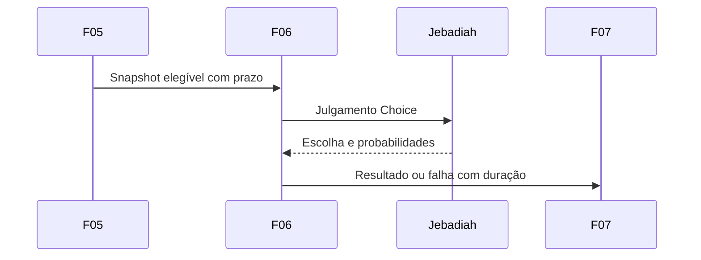

# F06 — Avaliação complementar com Jebadiah

**Fonte:** [PRD 0.2](../../PRD.md) · **Estado:** rascunho técnico para revisão. · [Contrato](contract.md) · [Plano](plan.md)

## Escopo e evidência

F06.1. Avaliar casos ambíguos com uma segunda indicação e possibilidade de abstenção, mantendo a decisão local fora do caminho de rede. O workspace contém o PRD e não tinha código ou configuração de build na inspeção. As decisões de implementação abaixo são propostas.

**Contratos de entrada:** [F05](../F05-cartao-flutuante/contract.md)

## Comportamento e aceite

| Caso | Condição | Resultado observável exigido |
| --- | --- | --- |
| F06-A | Oferta com conflito entre critérios flexíveis, vigente e sem veto | Enviar somente sinais normalizados necessários. No modo paralelo, registrar o resultado sem mudar o cartão. |
| F06-B | Veto, pendência obrigatória, resposta empatada, baixa confiança ou inválida | Não promover recomendação incompatível. Tratar distribuição inválida e política de abstenção com resultados distintos. |
| F06-C | Rede falha, solicitação vence ou oferta muda de ID ou revisão | Manter decisão local. Descartar resultado atrasado, inclusive se a invalidação vier antes de a inferência terminar. |
| F06-D | Modelo e política aprovados para o modo ao vivo | Aplicar somente resultado atual, válido e permitido por F05. Motivo composto a partir de sinais confirmados. |

## Decisões técnicas

Referências consultadas para o desenho do contrato. [Mater Dei](https://huggingface.co/spaces/furlanhleo/materdei-audit-jebadiah) · [Talk2Me](https://huggingface.co/spaces/furlanhleo/talk2me-jebadiah-zerogpu) · [Choice](https://docs.typesafe.ai/primitives/choice)

Proposta: gateway próprio com credencial do provedor no serviço e modelo/revisão fixados por rodada. Usar Choice com os quatro rótulos. A fila ZeroGPU serve para ensaio, sujeita a medição de partida, fila, rede e inferência. Os Spaces existentes são referências de validação de contrato e ciclo assíncrono, com contratos específicos de seus domínios.

## Estratégia de verificação

Cada caso (F06-A, F06-B, F06-C, F06-D) passa quando o resultado da tabela é observado pela interface do contrato ou pelo fluxo visível descrito no plano. Usar ofertas sintéticas para conformidade e regressão. Usar dados anonimizados ou aparelho real nos pontos de integração previstos no plano. Registrar variante, ambiente e evidência. [Gates e estado do repositório](../README.md#qualidade-e-evidências)
