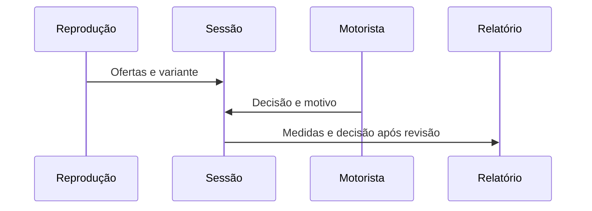

# F07 — Validação com motoristas

**Fonte:** [PRD 0.2](../../PRD.md) · **Estado:** rascunho técnico para revisão. · [Contrato](contract.md) · [Plano](plan.md)

## Escopo e evidência

F07.1. Comparar A (financeiro), B (financeiro + zonas e avaliações) e C (B + Jebadiah) e decidir quais sinais avançam. O workspace contém o PRD e não tinha código ou configuração de build na inspeção. As decisões de implementação abaixo são propostas.

**Contratos de entrada:** [F05](../F05-cartao-flutuante/contract.md)

## Comportamento e aceite

| Caso | Condição | Resultado observável exigido |
| --- | --- | --- |
| F07-A | Ofertas equivalentes, perfis e ordem alternada | Comparar dentro do mesmo perfil com rastreio de condição, escolha, tempo e motivo. Registrar decisão informada após revisão fora da janela curta. |
| F07-B | Ônus de espera, ausência de dados, conflito, perda de rede ou oferta substituída | Incluir a bateria do PRD. Contabilizar falhas de renderização, abstenções e respostas tardias, sem excluir casos silenciosamente. |
| F07-C | F06 indisponível ou cobertura pequena | Publicar A/B com denominadores. Informar C como pendente ou inconclusivo, conforme evidência. |

## Decisões técnicas

Proposta: sessões fora da condução, casos sintéticos ou anonimizados e coleta optativa. Usar grupos de ofertas pareadas com ordens alternadas e registrar condição sem mudar preferências dentro da comparação. Separar calibração de avaliação.

## Estratégia de verificação

Cada caso (F07-A, F07-B, F07-C) passa quando o resultado da tabela é observado pela interface do contrato ou pelo fluxo visível descrito no plano. Usar ofertas sintéticas para conformidade e regressão. Usar dados anonimizados ou aparelho real nos pontos de integração previstos no plano. Registrar variante, ambiente e evidência. [Gates e estado do repositório](../README.md#qualidade-e-evidências)
